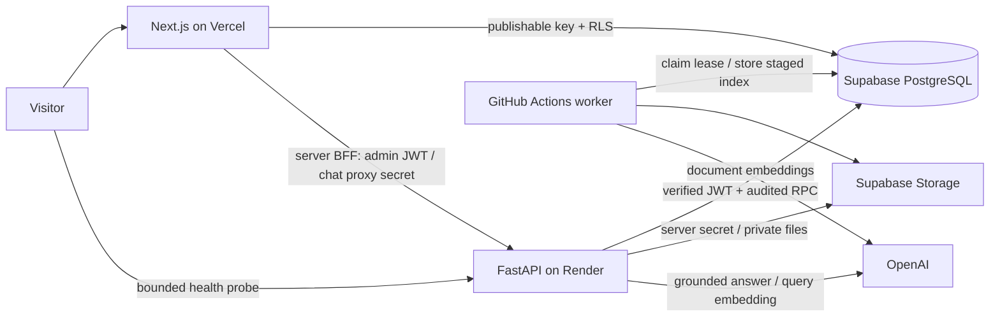

# Architecture and trade-offs

## Boundaries

Next.js public pages read explicit published fields through Supabase Data API with RLS and uncached reads. This keeps the portfolio usable while Render sleeps. Supabase Data API is the public backend for those reads. Administrative actions and AI processing use FastAPI. Personal facts live only in structured rows and approved documents; tests use isolated TEST fixtures.

Admin Auth stays in HttpOnly cookies. The Next.js server verifies the Supabase user and configured UUID before forwarding a JWT to FastAPI. FastAPI independently verifies the user using Supabase Auth, and the database independently checks private administrator membership. These checks protect against bypassing Next.js routes, forged tokens, and UI-only authorization. The frontend secret key is server-only and used solely for active Resume signing; it is never a NEXT_PUBLIC_ variable.

All mutations use allowlisted RPCs with a fixed empty search_path. The database owns transaction boundaries, audit records, optimistic revisions and idempotent request receipts. There is no LLM-generated SQL. Deletion is reversible soft deletion; restoration starts as a draft and does not restore knowledge approval. Profile keeps its earlier audit table; activity combines it with new generic audit events for compatibility.

## Document lifecycle

Validate a bounded file; upload under a random unique Storage path; register metadata and a durable job. Content hashes make retries safe for Resume/documents and same-project images. A definitive metadata rejection removes the unused upload. An uncertain server response retains the object because the transaction may have committed; investigate before removal.

The worker claims a leased job, verifies file hash, extracts text in bounded parsers, chunks by source section (1800 characters, approximately 200 overlap), embeds batches and writes a staged index. PDF pages are real parser page indices; DOCX has headings but no fabricated page numbers. Empty/scanned documents fail clearly. This baseline chunks by characters, not semantic boundaries; measure recall before tuning.

Jobs have desired version AND desired index identity. A stale worker cannot activate an older reindex of the same version. Promotion is atomic only after all staged chunks pass checks. Failed processing preserves the previous active index. Uploading a replacement clears approval until re-reviewed. Retrieval checks approval, deletion, active version/index, embedding model and related project visibility on every request. Source links also recheck those conditions. Old indexes are eventually removed, while original version metadata/files remain available for owner rollback.

GitHub Actions provides a low-traffic worker because Render Free sleeps and has no separate free background worker. The database queue is durable; schedule latency is not guaranteed. A future paid worker can run the same claim loop without changing the lifecycle. It needs no Redis at this scale.

## Chat and retrieval

The server issues a signed anonymous-session cookie; it is not a Supabase anonymous Auth account. An HMAC of the platform-provided IP is stored for rate limiting; raw IP is not persisted. The Next.js BFF forwards only this chat cookie, never the admin cookie. Per-IP admission is 10/minute, global concurrent admission 4, and daily quota reservations are serialized in PostgreSQL.

Basic skills/experience/list questions use current structured facts. Detail questions additionally embed a query and retrieve up to six cosine-similar approved chunks (threshold 0.25, 1536 dimensions). The baseline performs exact pgvector similarity with eligibility filtering, suitable for a small corpus; no premature approximate index or reranker. A short previous user question helps resolve follow-ups, but conversation history is never treated as verified evidence.

Context is bounded, ranked by simple lexical matches and document semantic rank, and passed to OpenAI Responses structured output. A stable behavior prompt treats documents/history as untrusted data. Unknown citations and unsupported output shapes fail closed to a missing-evidence response. The full answer is validated before SSE release. This validates citation identity and schema, not semantic entailment; prompt injection/hallucination cannot be guaranteed absent. Human reviewed evaluation remains necessary. A source withdrawn during an in-flight request may already be in that request's context; subsequent requests and source views recheck eligibility.

Costs use configured per-million token estimates. Chat reserves conservatively before paid work; document embeddings have a separate persistent budget. Failed/uncertain operations retain their reservation charge. Budget zero disables paid work, not health probes or public pages. Limits are application safeguards, not invoice reconciliation or organization-wide caps. Chat request/model/price settings must match on Render and worker where applicable.

## Retention and limitations

The worker removes chat text after 30 days and request/usage/evaluation metrics after 90 days, with cleanup delay determined by scheduler operation. Feedback follows message deletion. Conversations reset by clearing a browser cookie; that action does not immediately erase already retained messages. Private original files and audit records persist until owner maintenance. Project images are deliberately public assets: removing a record does not revoke a previously known public Storage URL.

Uploads through the web BFF are capped at 4 MB. No OCR, malware scanner, exact invoice reconciliation, token-by-token streaming, high availability promise, or full corpus semantic evaluation is claimed. Single admin, small dataset, sequential worker batches and bounded chat concurrency are deliberate initial constraints. Monitor actual traffic before adding queues, search indexes or orchestration frameworks.
